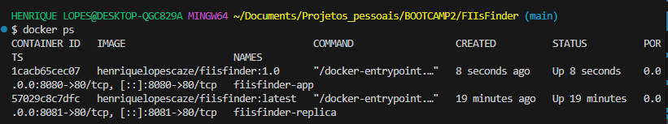

# FIIsFinder — Etapa 02 (Bootcamp II)

Aplicação web moderna para consulta, monitoramento e análise de cotações em tempo real de Fundos de Investimento Imobiliário (FIIs) listados na B3. O projeto evoluiu de uma Single Page Application (SPA) puramente estática da Etapa 01 para uma arquitetura robusta de microsserviço web com persistência em nuvem via **Supabase (BaaS)**, operações completas de **CRUD para carteira de favoritos**, conteinerização otimizada com **Docker e Nginx sobre Alpine Linux**, e cumprimento integral de todos os requisitos do edital e das quatro **Sidequests Oficiais (SQ1 a SQ4)**.

---

## Metadados e Autor

- **Projeto:** FIIsFinder (Evolução 2)
- **Autor:** Henrique Lopes Borges de Souza
- **Matrícula:** 22612443
- **Disciplina / Contexto:** Bootcamp II — Desenvolvimento Web, Persistência e Infraestrutura Conteinerizada

### Evolução Arquitetural: Da SPA Estática à Nuvem Conteinerizada
Na Etapa 01, o FIIsFinder operava como uma SPA front-end sem estado (*stateless*), consumindo dados dinâmicos da API externa da Brapi e sem qualquer mecanismo de retenção de dados entre sessões.

Na **Etapa 02**, a arquitetura foi substancialmente reestruturada:
1. **Camada de Persistência Relacional:** Integração direta com banco de dados PostgreSQL hospedado no **Supabase**, permitindo que o investidor salve, consulte, edite notas e remova ativos favoritos de forma persistente, com segurança garantida por **Row Level Security (RLS)**.
2. **Infraestrutura Conteinerizada:** Empacotamento completo da aplicação estática em uma imagem de contêiner leve e de alto desempenho utilizando **Nginx sobre Alpine Linux**, abstraindo o ambiente operacional e garantindo total reprodutibilidade tanto em desenvolvimento quanto em produção.

---

## Identidade e Links de Infraestrutura

- **Repositório do Projeto (GitHub):** [https://github.com/owmygod12/FIIsFinder](https://github.com/owmygod12/FIIsFinder)
- **Aplicação no ar (GitHub Pages):** [https://owmygod12.github.io/FIIsFinder/](https://owmygod12.github.io/FIIsFinder/)
- **Repositório no Docker Hub:** [https://hub.docker.com/r/henriquelopescaze/fiisfinder](https://hub.docker.com/r/henriquelopescaze/fiisfinder)
- **Imagem e Namespace Docker:** `henriquelopescaze/fiisfinder`
- **Tags Disponíveis no Registry:** `1.0`, `1.1` e `latest`
- **Painel do Banco de Dados (Supabase):** [https://supabase.com/](https://supabase.com/)
- **API Externa de Cotações (Brapi):** [https://brapi.dev/](https://brapi.dev/)

---

## Persistência de Dados (Supabase / PostgreSQL)

A persistência da carteira de favoritos utiliza um banco de dados relacional PostgreSQL gerenciado no Supabase. As interações ocorrem por meio do client oficial `@supabase/supabase-js`, garantindo tipagem consistente, integridade de dados e proteção em nível de linha.

### DDL de Criação da Tabela `favoritos_fiis`

```sql
CREATE TABLE public.favoritos_fiis (
    id BIGINT GENERATED ALWAYS AS IDENTITY PRIMARY KEY,
    criado_em TIMESTAMPTZ DEFAULT NOW() NOT NULL,
    ticker TEXT NOT NULL UNIQUE,
    nome TEXT NOT NULL,
    preco NUMERIC(10, 2) NOT NULL,
    dividend_yield NUMERIC(5, 2)
);
```

### Políticas de Segurança (Row Level Security - RLS)

Para garantir acesso controlado às operações de CRUD mantendo a simplicidade de consumo da chave pública anônima (`anon key`), o RLS foi habilitado na tabela com quatro políticas explícitas:

```sql
-- 1. Habilitação do Row Level Security
ALTER TABLE public.favoritos_fiis ENABLE ROW LEVEL SECURITY;

-- 2. Política de Leitura (SELECT)
CREATE POLICY "Permitir leitura publica" 
ON public.favoritos_fiis FOR SELECT 
USING (true);

-- 3. Política de Inserção (INSERT)
CREATE POLICY "Permitir insercao publica" 
ON public.favoritos_fiis FOR INSERT 
WITH CHECK (true);

-- 4. Política de Atualização (UPDATE)
CREATE POLICY "Permitir atualizacao publica" 
ON public.favoritos_fiis FOR UPDATE 
USING (true);

-- 5. Política de Exclusão (DELETE)
CREATE POLICY "Permitir exclusao publica" 
ON public.favoritos_fiis FOR DELETE 
USING (true);
```

### Dicionário de Dados

| Coluna | Tipo de Dado | Restrições | Descrição |
| :--- | :--- | :--- | :--- |
| `id` | `BIGINT` | `PRIMARY KEY`, `GENERATED ALWAYS AS IDENTITY` | Chave primária sequencial de 64 bits gerada automaticamente pelo PostgreSQL. |
| `criado_em` | `TIMESTAMPTZ` | `NOT NULL`, `DEFAULT NOW()` | Carimbo de data e hora UTC com fuso horário da inserção do registro. |
| `ticker` | `TEXT` | `NOT NULL`, `UNIQUE` | Código de negociação do ativo na B3 (ex: `MXRF11`, `HGLG11`). Restrição `UNIQUE` impede duplicidade na carteira. |
| `nome` | `TEXT` | `NOT NULL` | Razão social ou denominação oficial do FII reportada pela administradora. |
| `preco` | `NUMERIC(10, 2)` | `NOT NULL` | Cotação mais recente em reais (BRL), suportando até 8 dígitos inteiros e 2 casas decimais. |
| `dividend_yield` | `NUMERIC(5, 2)` | `NULLABLE` | Indicador percentual anualizado de rendimentos (DY %). Permite valor nulo caso indisponível na API. |

---

## Sidequests Oficiais (SQ1 a SQ4)

### SQ1 — Otimização do Contexto de Build (`.dockerignore`)

Para otimizar o processo de compilação da imagem Docker, foi configurado o arquivo `.dockerignore` na raiz do repositório, filtrando arquivos de desenvolvimento, logs e histórico:

```text
.git
.gitignore
README.md
plan.md
docker-ps.png
*.log
.DS_Store
Thumbs.db
```

#### Justificativa Técnica:
1. **Redução Drástica do Build Context:** Quando o comando `docker build` é disparado, o Docker CLI envia recursivamente o diretório atual via socket para o Docker Daemon. O diretório `.git` armazena histórico de commits, objetos binários e referências que não têm utilidade em tempo de execução web. A exclusão reduz expressivamente os megabytes trafegados, acelerando a fase inicial do build.
2. **Minimização do Tamanho Final da Imagem (~28.8 MB):** A imagem final baseada em `nginx:alpine` atinge apenas **~28.8 MB**. O uso do `.dockerignore` impede que o comando `COPY . /usr/share/nginx/html/` injete documentações pesadas, prints (`docker-ps.png`) ou artefatos transitórios na camada de arquivos da imagem servida pelo Nginx.
3. **Segurança e Higiene Operacional:** Previne o vazamento acidental de metadados de branches, credenciais temporárias ou informações estruturais do repositório dentro do contêiner publicado publicamente.

---

### SQ2 — Versionamento e Publicação de Imagens no Docker Hub

A imagem oficial do FIIsFinder foi tagueada e publicada no repositório oficial do Docker Hub (`henriquelopescaze/fiisfinder`), contemplando as três tags requeridas:

- **`1.0`**: Versão inicial estável da aplicação conteinerizada servida via Nginx Alpine.
- **`1.1`**: Versão incremental com refinamentos de layout, cabeçalhos de cache e integração Supabase.
- **`latest`**: Ponteiro padrão para a versão de produção mais atualizada.

#### Comandos de Tagging e Push Executados:
```bash
# Tagging a partir da imagem base estável (1.0) para 1.1 e latest
docker tag henriquelopescaze/fiisfinder:1.0 henriquelopescaze/fiisfinder:1.1
docker tag henriquelopescaze/fiisfinder:1.0 henriquelopescaze/fiisfinder:latest

# Publicação (Push) de todas as tags no repositório público
docker push henriquelopescaze/fiisfinder:1.0
docker push henriquelopescaze/fiisfinder:1.1
docker push henriquelopescaze/fiisfinder:latest
```

---

### SQ3 — Documentação e Overview no Docker Hub

A página oficial do repositório no Docker Hub foi estruturada com documentação técnica completa contendo:
1. **Descrição da Aplicação:** Apresentação clara do FIIsFinder como ferramenta web para monitoramento de Fundos Imobiliários da B3 com persistência no Supabase.
2. **Comando de Execução Rápida:** Instrução pronta para consumo imediato:
   ```bash
   docker run -d -p 8080:80 --name fiisfinder henriquelopescaze/fiisfinder:latest
   ```
3. **Link do Repositório GitHub:** Link direto para o código-fonte auditável: [https://github.com/owmygod12/FIIsFinder](https://github.com/owmygod12/FIIsFinder).

---

### SQ4 — Orquestração Local e Gestão de Escala com Kubernetes

#### 1. Execução Prática de Contêineres Simultâneos
Foram instanciados dois contêineres a partir das imagens publicadas, mapeados em portas distintas no host local:

```bash
# Inicialização do Contêiner 1 na porta 8080 (tag 1.0)
docker run -d -p 8080:80 --name fiisfinder-app henriquelopescaze/fiisfinder:1.0

# Inicialização do Contêiner 2 na porta 8081 (tag latest)
docker run -d -p 8081:80 --name fiisfinder-replica henriquelopescaze/fiisfinder:latest
```

Ambos os contêineres executam de forma totalmente isolada e paralela, acessíveis respectivamente em `http://localhost:8080` e `http://localhost:8081`.

#### Evidência de Execução (`docker ps`):
Abaixo encontra-se o registro visual comprovando ambos os contêineres em execução ativa (*Up*):



---

#### 2. Análise Teórica: Gestão e Escala de 100 Contêineres via Kubernetes

Operar 2 contêineres manualmente via CLI do Docker é trivial, contudo a administração manual de **100 contêineres** em ambiente de alta disponibilidade é operacionalmente inviável pelos seguintes desafios:
- Inexistência de balanceamento de carga nativo entre múltiplos servidores físicos.
- Impossibilidade de auto-recuperação (*self-healing*) em caso de falha de hardware ou processo.
- Conflitos de portas e complexidade no roteamento de rede.
- Dificuldade em aplicar atualizações sem interrupção de serviço (*rolling updates*).

Para sanar essas limitações, utiliza-se o **Kubernetes (K8s)** como orquestrador, alicerçado em três conceitos fundamentais:

```
+-----------------------------------------------------------------------------------+
|                                  KUBERNETES CLUSTER                               |
|                                                                                   |
|  +-----------------------------------------------------------------------------+  |
|  |                         CONTROL PLANE (MASTER)                              |  |
|  |   [API Server] <---> [etcd] <---> [Controller Manager] <---> [Scheduler]   |  |
|  +-----------------------------------------------------------------------------+  |
|                                         |                                         |
|                 +-----------------------+-----------------------+                 |
|                 |                                               |                 |
|  +-----------------------------+                 +-----------------------------+  |
|  |     WORKER NODE 01          |                 |     WORKER NODE 02          |  |
|  |  [Kubelet]   [Kube-Proxy]   |                 |  [Kubelet]   [Kube-Proxy]   |  |
|  |                             |                 |                             |  |
|  |  +-----------------------+  |                 |  +-----------------------+  |  |
|  |  |      POD (Replica)    |  |                 |  |      POD (Replica)    |  |  |
|  |  |  +-----------------+  |  |                 |  |  +-----------------+  |  |  |
|  |  |  | FIIsFinder App  |  |  |                 |  |  | FIIsFinder App  |  |  |  |
|  |  |  | (Nginx Alpine)  |  |  |                 |  |  | (Nginx Alpine)  |  |  |  |
|  |  |  +-----------------+  |  |                 |  |  +-----------------+  |  |  |
|  |  +-----------------------+  |                 |  +-----------------------+  |  |
|  |  ... até N pods             |                 |  ... até N pods             |  |
|  +-----------------------------+                 +-----------------------------+  |
+-----------------------------------------------------------------------------------+
```

##### 1. Cluster:
- O Cluster é a união lógica de servidores computacionais (físicos ou instâncias em nuvem) gerenciados de forma unificada.
- Divide-se entre o **Control Plane** (composto por API Server, etcd, Scheduler e Controller Manager) e os **Worker Nodes** (máquinas que executam as aplicações, contendo Kubelet, Kube-Proxy e o Container Runtime).
- Em uma escala de 100 contêineres, o **Scheduler** distribui automaticamente a carga computacional analisando limites de CPU e memória de cada nó, eliminando gargalos pontuais e garantindo alta disponibilidade física.

##### 2. Pod:
- O Pod é a **menor unidade atômica executável** no ecossistema Kubernetes. O Kubernetes não gerencia contêineres Docker isolados; ele instancia contêineres encapsulados dentro de Pods.
- Todos os contêineres de um Pod compartilham o mesmo endereço IP de rede, portas de escuta locais e volumes de armazenamento.
- No caso do FIIsFinder, cada Pod encapsula uma instância idêntica do Nginx servindo a SPA estática, operando como uma unidade descartável e replicável.

##### 3. Réplicas (Deployments, ReplicaSets, HPA e Self-Healing):
- **Declaração de Estado Desejado:** Através de um manifesto declarativo (`Deployment`), define-se `spec.replicas: 100`. O Kubernetes assegura continuamente que exatamente 100 instâncias estejam em execução por meio do ciclo de reconciliação (*reconciliation loop*).
- **Self-Healing (Auto-Recuperação):** Caso nós físicos falhem ou contêineres travem, o `ReplicaSet` detecta a divergência entre o estado real e o estado desejado, recriando novos Pods imediatamente em nós saudáveis, sem intervenção humana.
- **Service & Load Balancing:** Um recurso `Service` (como `LoadBalancer` ou `Ingress`) disponibiliza um único ponto de entrada para os usuários e balanceia o tráfego HTTP entre os 100 Pods ativos via round-robin.
- **Horizontal Pod Autoscaler (HPA):** Permite redimensionar dinamicamente o número de réplicas (por exemplo, reduzindo para 20 Pods na madrugada e escalando para 100 réplicas durante o horário de abertura do pregão da B3) com base na utilização de CPU, memória ou taxa de requisições.

---

## Como Executar Localmente

### Opção 1: Execução com Docker (Recomendada)

Com o Docker instalado em sua máquina, execute:

```bash
# 1. Baixar a imagem oficial diretamente do Docker Hub e iniciar o contêiner
docker run -d -p 8080:80 --name fiisfinder-app henriquelopescaze/fiisfinder:latest
```

Após a inicialização, acesse em seu navegador:
```text
http://localhost:8080
```

Para inspecionar os logs do servidor Nginx:
```bash
docker logs -f fiisfinder-app
```

Para pausar e remover o contêiner:
```bash
docker stop fiisfinder-app && docker rm fiisfinder-app
```

---

### Opção 2: Execução Estática Alternativa (Live Server)

Caso prefira executar sem o Docker, é possível servir os arquivos estáticos diretamente no navegador:

1. Clone o repositório do projeto:
   ```bash
   git clone https://github.com/owmygod12/FIIsFinder.git
   cd FIIsFinder
   ```

2. Certifique-se de que o arquivo `config.js` contenha as credenciais válidas do Supabase:
   ```javascript
   const SUPABASE_URL = "https://SEU-PROJETO.supabase.co";
   const SUPABASE_ANON_KEY = "SUA_CHAVE_ANONIMA_AQUI";
   ```

3. Abra o diretório no **VS Code**, clique com o botão direito sobre o arquivo `index.html` e selecione **"Open with Live Server"** (ou utilize qualquer servidor estático HTTP local, como `python -m http.server 8080` ou `npx serve .`).
