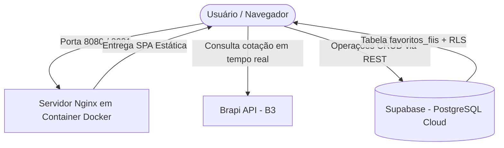

# FIIsFinder - Plano de Implementação Técnico (Etapa 02)

Planejamento arquitetural e estratégico oficial do projeto **FIIsFinder**, desenvolvido no âmbito do **Bootcamp II**. Este documento consolida a entrega da **Etapa 01** e estrutura integralmente a execução da **Etapa 02 (Evolução 2)** em estrita conformidade com o edital oficial da disciplina: persistência em nuvem com Supabase, CRUD completo, conteinerização com Docker e Nginx, execução das Sidequests obrigatórias (SQ1 a SQ4) e deploy final.

---

## 1. Visão Geral do Projeto

- **Aplicação:** FIIsFinder — Plataforma web para consulta e monitoramento de cotações de Fundos de Investimento Imobiliário (FIIs) da B3.
- **Autor:** Henrique Lopes Borges de Souza — Matrícula 22612443
- **Repositório:** [GitHub - owmygod12/FIIsFinder](https://github.com/owmygod12/FIIsFinder)
- **Deploy Etapa 01:** [FIIsFinder no GitHub Pages](https://owmygod12.github.io/FIIsFinder/)
- **Stack Tecnológica da Etapa 02:**
  - **Frontend:** HTML5 Semântico, Vanilla CSS (Design Tokens, Dark Theme FinTech) e Vanilla JavaScript (ES6+ modular, zero dependências pesadas).
  - **API Externa:** [Brapi API](https://brapi.dev/) (`https://brapi.dev/api/quote/{ticker}`).
  - **BaaS / Banco de Dados:** [Supabase](https://supabase.com/) (PostgreSQL gerenciado na nuvem, `@supabase/supabase-js`, Row Level Security - RLS).
  - **Conteinerização & Web Server:** Docker e Nginx (`nginx:alpine`), garantindo portabilidade, isolamento e consumo mínimo de memória.

---

## 2. Retrospectiva Consolidada: Etapa 01 (Fases 1 a 5)

A Etapa 01 estabeleceu a fundação da Single Page Application (SPA), entregando:

| Fase | Escopo Técnico | Status |
| :--- | :--- | :---: |
| **Fase 1** | Estrutura HTML5 Semântica, CSS Reset e Tokens de Design no `:root`. | Concluída |
| **Fase 2** | Componentização da UI: Seção de busca, card hero de resultados, spinners e layout responsivo. | Concluída |
| **Fase 3** | Máquina de Estados da UI (`idle`, `loading`, `error`, `success`) e validação estrita de input (mínimo de 6 caracteres). | Concluída |
| **Fase 4** | Integração com a API Brapi e proteção contra *Race Conditions* com `AbortController`. | Concluída |
| **Fase 5** | Parsing de dados, formatação monetária padrão BRL (`Intl.NumberFormat`), tratamento de exceções HTTP (404, 429, 500) e fallback de imagens. | Concluída |

---

## 3. Planejamento Estratégico: Etapa 02 (Sprints 6 a 10)

A Etapa 02 transforma o FIIsFinder em uma aplicação corporativa com persistência em nuvem, controle de carteira de favoritos, ambiente conteinerizado e publicação em registry oficial.



---

### Sprint 6: Configuração do Supabase e Tabela `favoritos_fiis`

**Objetivo:** Integrar a camada de Backend as a Service (BaaS) com PostgreSQL na nuvem e configurar a persistência relacional com o schema estrito da disciplina.

- **Atividades Técnicas:**
  1. **Provisionamento do Supabase:**
     - Criação do projeto no console do Supabase e extração de `SUPABASE_URL` e `SUPABASE_ANON_KEY`.
     - Configuração do arquivo [config.js](file:///c:/Users/USUARIO/Documents/Projetos_pessoais/BOOTCAMP2/FIIsFinder/config.js) com as variáveis públicas documentadas.
  2. **Modelagem e DDL Estrito da Tabela `favoritos_fiis`:**
     - Execução do script DDL oficial no SQL Editor:
       ```sql
       CREATE TABLE public.favoritos_fiis (
           id BIGINT GENERATED ALWAYS AS IDENTITY PRIMARY KEY,
           criado_em TIMESTAMP WITH TIME ZONE DEFAULT NOW() NOT NULL,
           ticker TEXT NOT NULL UNIQUE,
           nome TEXT NOT NULL,
           preco NUMERIC(10, 2) NOT NULL,
           dividend_yield NUMERIC(5, 2)
       );
       ```
  3. **Configuração de Políticas de Segurança (Row Level Security - RLS):**
     - Ativação do RLS na tabela:
       ```sql
       ALTER TABLE public.favoritos_fiis ENABLE ROW LEVEL SECURITY;
       ```
     - Definição das políticas para a chave anônima pública (`anon_key`):
       - `SELECT`: Consulta pública de favoritos cadastrados.
       - `INSERT`: Inserção com validação de ticker único.
       - `UPDATE`: Atualização de cotação e dividend yield.
       - `DELETE`: Exclusão de itens pelo identificador primário `id`.
  4. **Integração do Cliente Supabase:**
     - Inclusão do SDK oficial via CDN no `index.html` (`@supabase/supabase-js`).
     - Inicialização do client `supabase.createClient(SUPABASE_URL, SUPABASE_ANON_KEY)` e validação da conexão.

---

### Sprint 7: CRUD Completo na Interface

**Objetivo:** Desenvolver todas as operações de manipulação da carteira de favoritos diretamente na interface gráfica.

- **Atividades Técnicas:**
  1. **Create (Favoritar Ativo):**
     - Botão interativo de favoritar no card de resultados da consulta.
     - Validação para evitar inserção duplicada do mesmo `ticker`.
     - Persistência dos campos `ticker`, `nome`, `preco` e `dividend_yield` no Supabase via `supabase.from('favoritos_fiis').insert([...])`.
  2. **Read (Listar Favoritos):**
     - Criação da seção de favoritos no DOM (`#favorites-section`).
     - Consulta automática ordenada por data: `supabase.from('favoritos_fiis').select('*').order('criado_em', { ascending: false })`.
     - Renderização de lista/grid de cards com estados visuais de carregamento e estado vazio.
  3. **Update (Sincronizar / Atualizar Cotação):**
     - Ação de recarregar cotação e dividend yield atualizados a partir da Brapi e atualizar o registro persistido via `supabase.from('favoritos_fiis').update({...}).eq('id', id)`.
  4. **Delete (Remover Favorito):**
     - Botão de exclusão em cada item favoritado.
     - Execução atômica da exclusão: `supabase.from('favoritos_fiis').delete().eq('id', id)` e remoção imediata do elemento visual no DOM.
  5. **Feedback Visual:** Indicadores visuais de processamento, bloqueio de ações simultâneas e toasts de confirmação.

---

### Sprint 8: Conteinerização com Docker e Nginx

**Objetivo:** Empacotar a aplicação em uma imagem Docker padronizada e leve utilizando servidor web Nginx.

- **Atividades Técnicas:**
  1. **Criação do `Dockerfile`:**
     - Imagem base `nginx:alpine` para mínima superfície de ataque e baixo tamanho.
     - Cópia dos arquivos estáticos da SPA (`index.html`, `style.css`, `script.js`, `config.js`) para `/usr/share/nginx/html`.
     - Exposição da porta `80`.
  2. **Configuração do Servidor Web (`nginx.conf`):**
     - Definição do bloco de servidor escutando na porta 80, suporte a MIME types corretos, compressão gzip e fallback de rotas SPA (`try_files $uri $uri/ /index.html =404;`).
  3. **Validação Local:**
     - Compilação da imagem: `docker build -t fiisfinder .`
     - Teste de execução: `docker run -d -p 8080:80 --name fiisfinder-test fiisfinder`.

---

### Sprint 9: Execução das Sidequests Oficiais (SQ1 a SQ4)

**Objetivo:** Cumprir rigorosamente os quatro entregáveis de infraestrutura e engenharia de software estipulados pelo edital da disciplina.

- **SQ1 — Otimização de Build com `.dockerignore`:**
  - Criação do arquivo `.dockerignore` na raiz do projeto, excluindo estritamente: `.git`, `README.md`, `plan.md`, arquivos temporários e logs.
  - Documentação da justificativa técnica detalhando a redução do *build context* enviado ao Docker daemon, ganho de performance no build e redução do tamanho e vulnerabilidades da imagem final.
- **SQ2 — Versionamento de Imagens no Docker Hub:**
  - Criação de repositório público no Docker Hub: `owmygod12/fiisfinder`.
  - Geração e publicação das três tags obrigatórias:
    - `1.0`: Release inicial da imagem conteinerizada.
    - `1.1`: Versão incremental com refinamentos de layout e cache.
    - `latest`: Ponteiro para a versão de produção mais recente.
  - Comandos executados: `docker tag fiisfinder:latest owmygod12/fiisfinder:1.0`, etc., e `docker push`.
- **SQ3 — Overview Técnico no Docker Hub:**
  - Elaboração da documentação da página oficial do repositório no Docker Hub com:
    1. Descrição clara e concisa da aplicação FIIsFinder.
    2. Comando pronto para execução imediata (`docker run -d -p 8080:80 owmygod12/fiisfinder:latest`).
    3. Link direto para o repositório no GitHub.
- **SQ4 — Orquestração Local e Gestão de Escala com Kubernetes:**
  - **Prática:** Execução simultânea de 2 contêineres a partir da mesma imagem em portas distintas (`8080` e `8081`):
    - `docker run -d -p 8080:80 --name fiisfinder-app-1 owmygod12/fiisfinder:latest`
    - `docker run -d -p 8081:80 --name fiisfinder-app-2 owmygod12/fiisfinder:latest`
  - **Evidência:** Execução do comando `docker ps`, captura de tela demonstrando ambos os contêineres em status *Up* e inclusão do arquivo de print no repositório (`docker-ps.png`).
  - **Seção Teórica no README:** Análise fundamentada da transição de escala de 2 para 100 contêineres utilizando Kubernetes (K8s), detalhando os pilares:
    - **Cluster:** Estrutura unificada de nós de controle (Control Plane) e nós de trabalho (Worker Nodes) para distribuição e gestão de recursos físicos/virtuais.
    - **Pod:** Menor unidade executável do ecossistema, encapsulando o contêiner com namespaces e rede compartilhada.
    - **Réplicas (Deployments / ReplicaSets):** Mecanismo de estado desejado que garante a disponibilidade contínua de 100 réplicas ativas, recuperação automática (*self-healing*) e balanceamento de tráfego.

---

### Sprint 10: Documentação e Deploy Final

**Objetivo:** Consolidar toda a entrega técnica, validar links públicos e formalizar a entrega da Etapa 02.

- **Atividades Técnicas:**
  1. **Atualização Completa do `README.md`:**
     - Seção dedicada ao Supabase e ao schema estrito da tabela `favoritos_fiis`.
     - Instruções detalhadas de execução local e via Docker.
     - Justificativa técnica do `.dockerignore` (SQ1).
     - Relação das tags publicadas no Docker Hub (SQ2).
     - Overview e instruções de execução (SQ3).
     - Registro dos contêineres paralelos e estudo de escala com Kubernetes (SQ4).
  2. **Auditoria e Entrega:**
     - Verificação de acessibilidade e funcionamento dos links de infraestrutura.
     - Tag de release `v2.0.0` no repositório Git.

---

## 4. Matriz de Rastreabilidade e Critérios de Aceite

| Sprint / Item | Entregável Principal | Critério de Aceite Estrito |
| :--- | :--- | :--- |
| **Sprint 6** | Tabela `favoritos_fiis` no Supabase | Schema exato (`id`, `criado_em`, `ticker`, `nome`, `preco`, `dividend_yield`) com RLS habilitado. |
| **Sprint 7** | Interface com CRUD Completo | Adição, listagem, atualização e deleção de favoritos persistidos funcionando na UI. |
| **Sprint 8** | Conteinerização Docker + Nginx | `Dockerfile` funcional rodando em `nginx:alpine` na porta 80. |
| **SQ1** | Arquivo `.dockerignore` | Arquivo criado ignorando `.git`, `README.md` e temporários com justificativa técnica. |
| **SQ2** | Tags no Docker Hub | Tags `1.0`, `1.1` e `latest` geradas e enviadas ao Docker Hub. |
| **SQ3** | Documentação Docker Hub | Overview com descrição, comando `docker run` pronto e link do repositório GitHub. |
| **SQ4** | 2 Containers + Teoria Kubernetes | 2 containers rodando em `8080` e `8081`, print do `docker ps` e ensaio teórico sobre Cluster, Pod e Réplicas. |
| **Sprint 10** | Documentação e Deploy | README e plan.md perfeitamente alinhados ao edital, sem dados ou colunas fictícias. |
